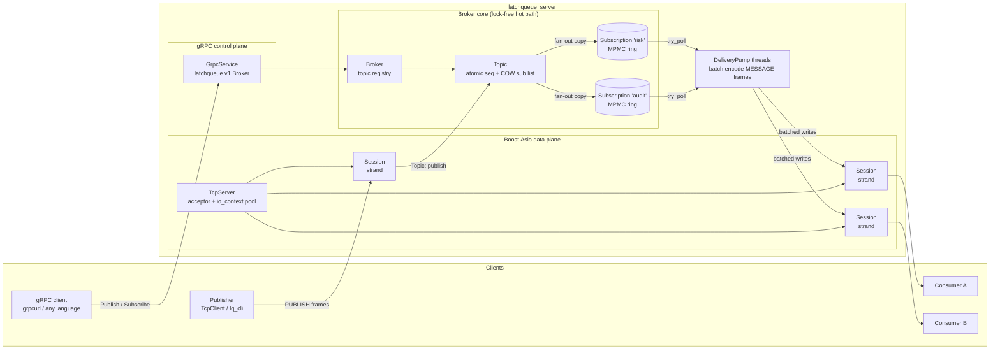

# LatchQueue

LatchQueue is a lock-free, low-latency message queue written in **C++17**. Its hot path is
built on bounded lock-free **MPMC ring buffers** (Vyukov-style per-slot sequence numbers).
Clients use a compact binary protocol over **Boost.Asio** TCP, and a **gRPC** service
provides management and a language-neutral publish/subscribe API.

The design targets **2M+ messages/second** through the in-process queue path, with
**sub-microsecond** enqueue-to-dequeue handoff. `bench/` contains benchmarks to verify this
on your hardware.

## Features

- **Lock-free MPMC queue.** It is bounded and power-of-two sized, with cache-line-padded
  head/tail. Producers and consumers contend only on a CAS of the head/tail counter, never on
  a lock.
- **SPSC ring.** A Lamport queue with cached opposite indices, for single-producer pipelines.
- **Pluggable wait strategies.** You can choose `BusySpinWait` (lowest latency, uses a whole
  core), `SpinYieldWait`, or `SpinParkWait` (spin, then yield, then park on a condvar).
- **Fixed 256-byte `Message` records.** Each one has a 24-byte header and a 232-byte inline
  payload, is trivially copyable, and never causes an allocation on the hot path.
- **Topics, fan-out and consumer groups:**
  - Every *subscription* on a topic receives every message.
  - Consumers that share a subscription name compete for messages (work queue).
- **Overflow policies, set per subscription:**
  - `DROP_NEWEST`: publishers never block, and drops are counted.
  - `BLOCK`: back-pressure. A blocked publisher still bails out if the subscription is
    closed.
- **Copy-on-write subscription lists.** Publishers iterate an atomic snapshot without
  locking.
- **Asio TCP data plane:**
  - One strand per connection.
  - Double-buffered batched writes.
  - Delivery pump threads that batch up to 256 messages into a single write, and pause a
    binding when its session backlog grows too large.
- **gRPC control plane:** `CreateTopic`, `DeleteTopic`, `ListTopics`, `Publish`,
  client-streaming `PublishStream`, server-streaming `Subscribe`, `Unsubscribe` and
  `GetStats`.
- **Latency metrics.** A lock-free log-linear (HDR-style) histogram tracks publish-to-consume
  latency for each subscription and reports p50, p99 and p99.9.

## Architecture



### Message flow

1. A publisher sends a `PUBLISH` frame. The session's strand decodes it and calls
   `Topic::publish`. That call stamps a sequence number and a monotonic timestamp, then
   copies the 256-byte `Message` into every subscription's MPMC ring.
2. Each `(session, subscription)` binding is owned by exactly one delivery pump thread. The
   pump drains up to 256 messages, encodes them as `MESSAGE` frames into one buffer, and
   hands that buffer to the session.
3. The session appends the buffer to its outbound queue and issues a single `async_write`.
   If a slow client lets its backlog grow past 8 MiB, the pump stops draining that binding.
   The subscription's overflow policy then decides whether new messages are dropped or
   publishers wait.

Delivery is **at-most-once**. Messages live only in memory, and a message that has been
polled for a connection that then drops is lost.

### Wire protocol

All integers are little-endian:

```
| u32 len | u8 type | u32 request_id | body ... |
```

| Frame | Direction | Body |
|---|---|---|
| `HELLO` | C→S | `u16 version, str client_name` |
| `CREATE_TOPIC` | C→S | `str name` → `ACK(topic_id)` |
| `PUBLISH` | C→S | `u32 topic_id, u8 want_ack, bytes payload` → optional `ACK(sequence)` |
| `SUBSCRIBE` | C→S | `u32 topic_id, u8 policy, u32 capacity, str name` → `ACK(handle)` |
| `UNSUBSCRIBE` | C→S | `u32 handle` → `ACK(handle)` |
| `PING` / `PONG` | both | empty |
| `MESSAGE` | S→C | `request_id = handle; u32 topic_id, u64 seq, u64 publish_ts_ns, bytes` |
| `ERROR` | S→C | `u16 code, str message` |

## Project layout

```
include/latchqueue/        header-only primitives + public API
  mpmc_queue.hpp           Vyukov bounded MPMC ring
  spsc_queue.hpp           Lamport SPSC ring
  wait_strategy.hpp        busy-spin / spin-yield / spin-park
  message.hpp              256-byte Message record
  subscription.hpp topic.hpp broker.hpp histogram.hpp stats.hpp
  net/                     protocol, session, delivery pump, TCP server
  rpc/grpc_service.hpp     gRPC service + server wrapper
  client/tcp_client.hpp    synchronous TCP client
src/                       implementations, server_main.cpp, config.cpp
proto/latchqueue.proto     gRPC service definition
tools/lq_cli.cpp           command-line client
tests/                     GoogleTest unit + integration tests
bench/                     mpmc_bench, broker_bench, tcp_bench
```

## Building

**Requirements:**

- A C++17 compiler (GCC 9+, Clang 10+ or Apple Clang 12+)
- CMake 3.16+
- Boost 1.74+ (headers only)
- gRPC and Protobuf with CMake config packages. These are only needed for the gRPC control
  plane.

```bash
# macOS
brew install cmake boost grpc protobuf
# Debian/Ubuntu
sudo apt install cmake g++ libboost-dev libgrpc++-dev protobuf-compiler-grpc libprotobuf-dev
```

```bash
cmake -S . -B build -DCMAKE_BUILD_TYPE=Release
cmake --build build -j
```

**Build options:**

| Option | Default | Description |
|---|---|---|
| `LQ_BUILD_GRPC` | `ON` | Build the gRPC service. Use `OFF` to build without gRPC/Protobuf. |
| `LQ_BUILD_TESTS` | `ON` | GoogleTest suites. GoogleTest is fetched automatically. |
| `LQ_BUILD_BENCH` | `ON` | Benchmarks. |
| `LQ_NATIVE` | `OFF` | Compile with `-march=native`. |

```bash
# Minimal build with no gRPC dependency
cmake -S . -B build -DLQ_BUILD_GRPC=OFF && cmake --build build -j
```

## Running

```bash
./build/latchqueue_server --topics orders,ticks
# [tcp] listening on 0.0.0.0:7400 (2 io threads, 1 pump threads)
# [grpc] listening on 0.0.0.0:7401
```

You can configure the server with CLI flags or `LQ_*` environment variables (see
`.env.example`). Run `latchqueue_server --help` for the full list. The main settings are
`--tcp-port`, `--grpc-address`, `--io-threads`, `--pump-threads`, `--queue-capacity` and
`--stats-interval`.

**With the CLI:**

```bash
# Terminal 1: consume as consumer group "risk"
./build/lq_cli sub orders --group risk

# Terminal 2: publish
./build/lq_cli pub orders "BUY 100 AAPL @ 189.20"
./build/lq_cli pub orders "tick" --count 1000000    # fire-and-forget throughput run
./build/lq_cli ping --count 1000                    # round-trip latency
```

**With gRPC** (for example, using [grpcurl](https://github.com/fullstorydev/grpcurl)):

```bash
grpcurl -plaintext -import-path proto -proto latchqueue.proto \
  -d '{"name":"orders"}' localhost:7401 latchqueue.v1.Broker/CreateTopic

grpcurl -plaintext -import-path proto -proto latchqueue.proto \
  -d '{"topic":"orders","payload":"aGVsbG8="}' localhost:7401 latchqueue.v1.Broker/Publish

grpcurl -plaintext -import-path proto -proto latchqueue.proto \
  -d '{"topic":"orders","subscription":"ui"}' localhost:7401 latchqueue.v1.Broker/Subscribe

grpcurl -plaintext -import-path proto -proto latchqueue.proto \
  localhost:7401 latchqueue.v1.Broker/GetStats
```

**As a library:**

```cpp
#include "latchqueue/mpmc_queue.hpp"

latchqueue::MpmcQueue<Order, latchqueue::BusySpinWait> q(1 << 16);
q.push(order);            // or try_push
Order o; q.pop(o);        // or try_pop / pop_for
```

## Testing

```bash
cmake -S . -B build -DLQ_BUILD_TESTS=ON
cmake --build build -j
ctest --test-dir build --output-on-failure
```

- `latchqueue_tests` covers:
  - MPMC correctness, with 4 producers and 4 consumers moving 800k values and every value
    seen exactly once.
  - Per-producer FIFO ordering.
  - Wrap-around and element destruction.
  - SPSC ordering.
  - Histogram precision.
  - Broker fan-out, consumer groups and overflow policies.
  - Unsubscribing a subscription that a publisher is blocked on.
  - Protocol encode/decode round-trips.
- `latchqueue_integration_tests` starts a real `TcpServer` on an ephemeral loopback port. It
  checks publish/subscribe ordering, competing consumers with no duplicate deliveries, error
  frames, and ping.

For concurrency bugs, build with a sanitizer:

```bash
cmake -S . -B build-tsan -DCMAKE_BUILD_TYPE=RelWithDebInfo -DLQ_BUILD_GRPC=OFF \
  -DCMAKE_CXX_FLAGS="-fsanitize=thread"
cmake --build build-tsan -j && ctest --test-dir build-tsan
```

## Benchmarks

```bash
./build/mpmc_bench --producers 2 --consumers 2 --messages 20000000 --pin
./build/mpmc_bench --sweep          # 1P/1C, 2P/2C, 4P/4C, 4P/1C, 1P/4C
./build/mpmc_bench --latency --pin  # one-way handoff p50/p99/p99.9
./build/broker_bench --publishers 2 --consumers 2 --fanout 2 --payload 64
./build/tcp_bench --messages 1000000                 # in-process server over loopback
./build/tcp_bench --host 127.0.0.1 --port 7400       # against a running server
```

The results depend on your hardware. For the best numbers, use a Release build, run on Linux
with `--pin` (CPU affinity), give each pinned thread its own physical core, and use
`BusySpinWait`. The MPMC queue clears the 2M msg/s target by a wide margin on any modern
multi-core CPU. End-to-end TCP numbers are bounded by syscalls and loopback.

## Limitations and future work

- The queue is in-memory only, with no persistence or replication.
- There is no TLS or authentication on either plane.
- Payloads are capped at 232 bytes. Larger messages would need chunking or an out-of-line
  slab allocator.
- The TCP client is synchronous. An async client and language bindings over gRPC would be
  natural next steps.
